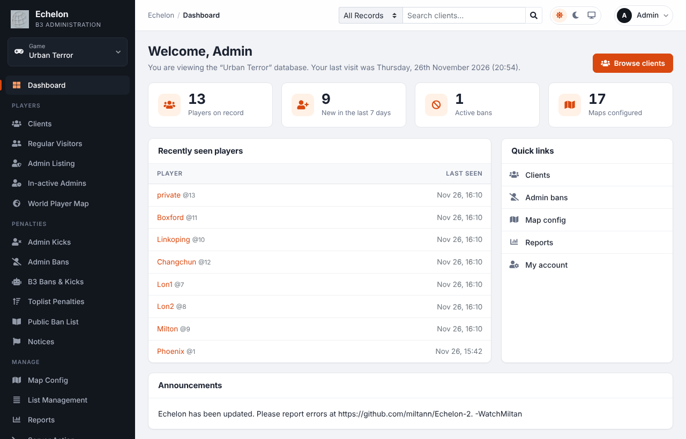
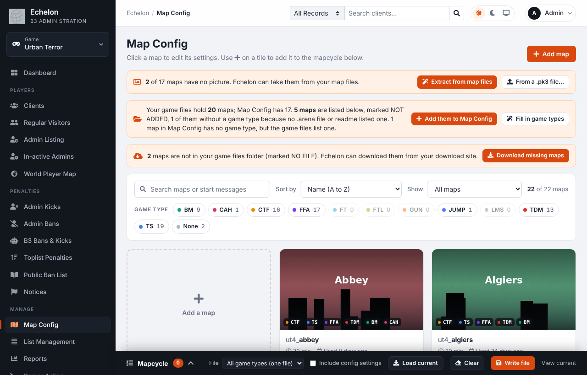

# Echelon 3

Web administration and investigation tool for [Big Brother Bot (B3)](http://bigbrotherbot.net) game servers: players, bans, penalties, reports, admin tools and maps in one place. A rebuild of Echelon 2 for **PHP 8.1+** with a cleaner interface, light, dark and system themes, a tile-board **Map Config**, and a world map of where your players connect from.

**Echelon 3** — the PHP 8.1+ upgrade, new interface, Map Config, map downloads, mapcycle editing, installer and user guide — was built by **Aciddrop** ([@Aciddrop](https://github.com/aciddrop75)). It is a fork of [dkman123/Echelon-2](https://github.com/dkman123/Echelon-2), which is itself a fork of [miltann/Echelon-2](https://github.com/miltann/Echelon-2).



## What is new

* Runs on **PHP 8.1 and newer** (tested on 8.3). Safer forms (CSRF protection) and modern database code.
* New look with **light, dark and system** themes, and the original Echelon logo.
* **Map Config** board with map pictures, game types read from `.arena` files, every map in your game files listed, and a gear calculator.
* **Mapcycle editing** straight to the real mapcycle files through links inside Echelon, with **custom game types** that get a mapcycle file of their own.
* **Download missing maps** from sites you choose.
* **World map** with OpenStreetMap tiles (no API key) and optional MaxMind GeoLite2 city lookups.
* **Linux installer** that backs up your old Echelon (files and database), upgrades it, and rolls back by itself if something fails. A step-by-step guide for Windows.

See [CHANGES.md](CHANGES.md) for the full list.



## Install

**Read the illustrated guide first:** [docs/Echelon-3-User-Guide.pdf](docs/Echelon-3-User-Guide.pdf) (install, upgrade, add a game and a server, Map Config, mapcycle, troubleshooting).

**Linux** (Debian, Ubuntu, RHEL family; Apache or nginx):

```bash
git clone https://github.com/YOUR-USERNAME/echelon-3.git
cd echelon-3/installer
sudo ./install.sh --check   # only looks, changes nothing
sudo ./install.sh           # asks only what it cannot find out itself
```

**Windows** (XAMPP, WAMP or IIS): follow [installer/INSTALL-WINDOWS.md](installer/INSTALL-WINDOWS.md).

Upgrading is safe to try: your old files and database are saved first, and going back is one command on Linux (`sudo <backup folder>/revert.sh`) or the "Going back" section of the Windows guide.

## Requirements

* PHP **8.1 or newer** with `mysqli`, `gd`, `zip`, `fileinfo`, `mbstring`; `curl` for the optional map downloads
* MySQL 5.7+ or MariaDB 10.3+
* Apache (`.htaccess` included), nginx (rules in the Linux guide) or IIS (`web.config` included)
* A browser with internet access, so the world map can load map tiles

## Repository layout

| Path | What it is |
|---|---|
| `echelon/` | The website itself. This is what goes on your web server |
| `installer/` | Linux `install.sh` and `revert.sh`, the Linux and Windows guides, and the SQL scripts |
| `docs/` | The illustrated user guide (PDF), its screenshots, and the original Echelon 2 README |
| `CHANGES.md` | What changed from Echelon 2 |

## Security notes

* Never commit your real `echelon/inc/config.php` (it holds your database password). The file in this repository is only the "not installed yet" placeholder.
* Delete `echelon/install/` after installing.
* Report security problems privately to the repository owner rather than in a public issue.

## Credits and licence

**Echelon 3 (2026): upgrades and rebuild by YOUR-NAME** ([@YOUR-USERNAME](https://github.com/YOUR-USERNAME)): PHP 8.1+ port, new interface and themes, Map Config board, map downloads, mapcycle editing, Linux installer with backup and revert, Windows guide, and the illustrated user guide.

**Earlier work:** Echelon is based on the work of WatchMiltan, Eire32 and the Big Brother Bot developers; Echelon 2 by [miltann](https://github.com/miltann/Echelon-2), [dkman123](https://github.com/dkman123/Echelon-2) and contributors. Their commit history is kept in this repository.

Map tiles © OpenStreetMap contributors; maps by [Leaflet](https://leafletjs.com); icons by Font Awesome Free. GeoLite2 data is created by [MaxMind](https://www.maxmind.com) and used under its licence when you enable it. Third-party libraries in `echelon/vendor/` keep their own licences.

The original Echelon files are copyrighted by their authors (see [docs/README-Echelon-2-original.md](docs/README-Echelon-2-original.md)). No licence file is included: the upstream repository shows none, so the repository owner needs to choose one that fits what the original authors allow.
